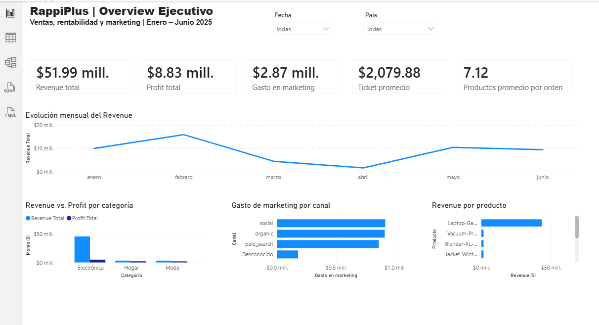
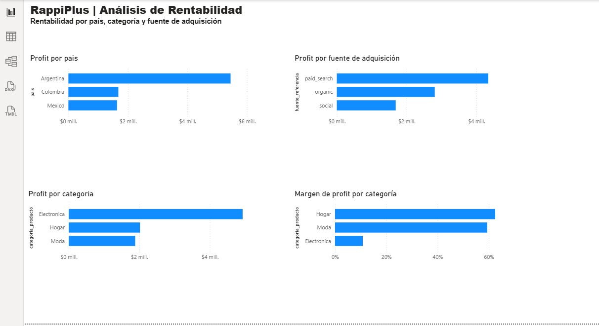
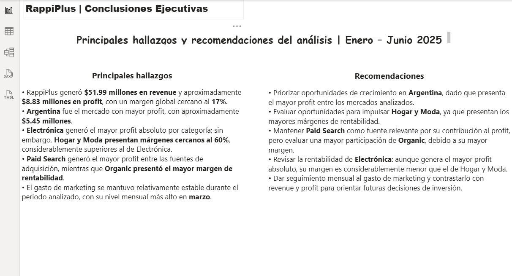

# RappiPlus: de datos a decisiones de negocio

## Descripción del proyecto

Proyecto de análisis de datos enfocado en evaluar el desempeño del servicio RappiPlus y apoyar la toma de decisiones de negocio mediante el análisis de información de pedidos, productos, marketing y comportamiento de usuarios.

El proyecto integra distintas etapas del trabajo de análisis de datos: validación y limpieza de información, análisis exploratorio, evaluación de rentabilidad, análisis del funnel de conversión, retención de usuarios, experimentación A/B y comunicación de resultados mediante visualizaciones y Power BI.

## Objetivos del análisis

El análisis busca responder preguntas relacionadas con:

- La calidad y confiabilidad de los datos disponibles.
- El desempeño económico y la rentabilidad del negocio.
- Los puntos del proceso donde se pierden usuarios.
- El comportamiento de retención de los usuarios.
- La existencia de diferencias estadísticamente significativas en un experimento A/B.
- La comunicación de los principales resultados mediante indicadores y visualizaciones.

## Mi contribución

Desarrollé el proceso de análisis desde la preparación de los datos hasta la interpretación de los resultados.

Entre las principales actividades realizadas se encuentran:

- Limpieza y validación de datos con Python y Pandas.
- Análisis exploratorio de información de pedidos, productos y marketing.
- Análisis de ingresos, costos y rentabilidad.
- Análisis del funnel de conversión.
- Análisis de retención mediante cohortes.
- Consulta y análisis de información utilizando SQL.
- Evaluación de un experimento A/B mediante una prueba estadística.
- Preparación de indicadores y visualizaciones para comunicar los resultados.
- Desarrollo de un dashboard en Power BI.

## Decisiones de análisis

Durante el proyecto prioricé primero la validación de la calidad de los datos antes de interpretar los resultados del negocio.

Posteriormente, organicé el análisis en diferentes perspectivas: rentabilidad, conversión y retención. Para el experimento A/B utilicé una prueba estadística para evaluar si la diferencia observada entre los grupos proporcionaba evidencia suficiente para respaldar una decisión.

Esto permitió evitar conclusiones basadas únicamente en diferencias descriptivas y mantener una interpretación respaldada por los resultados del análisis.

## Resultado y aprendizaje

El proyecto permitió integrar diferentes técnicas de análisis dentro de un mismo problema de negocio y transformar los datos disponibles en información estructurada para apoyar la interpretación del desempeño de RappiPlus.

En el análisis A/B, la tasa observada fue de 15.69 % para el grupo de control y 16.29 % para el grupo de tratamiento. Sin embargo, el resultado de la prueba estadística (`p = 0.4161`) no proporcionó evidencia suficiente para afirmar que existiera una diferencia estadísticamente significativa entre los grupos.

Por ello, no se recomendó implementar el tratamiento únicamente con base en la diferencia observada.

Uno de los principales aprendizajes del proyecto fue la importancia de validar la calidad de los datos y utilizar evidencia estadística antes de formular recomendaciones de negocio.

## Herramientas utilizadas

- Python
- Pandas
- SQL
- Power BI
- Power Query
- Jupyter Notebook
- Análisis estadístico
- Visualización de datos

## Evidencias del proyecto

El análisis completo puede consultarse en el siguiente notebook:

➡️ [Ver notebook de análisis de RappiPlus](rappiplus_analysis.ipynb)

### Dashboard en Power BI

A continuación se presentan algunas de las principales vistas desarrolladas para comunicar los resultados del análisis.

#### Overview Ejecutivo

#### Análisis de Rentabilidad

#### Conclusiones Ejecutivas

## Autora

**Denisse Ungson**  
Analista de Datos Junior
